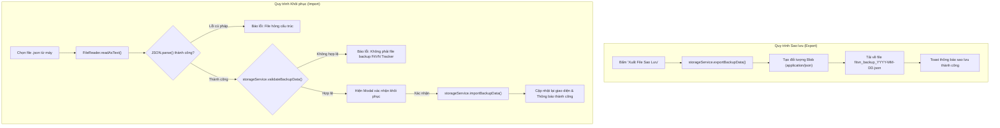

# Tài Liệu Đặc Tả Tính Năng: Cài Đặt Cá Nhân & Sao Lưu Dữ Liệu Người Dùng
**Mã tài liệu:** `cai-dat-va-sao-luu-du-lieu.fea.md`  
**Dự án:** FitVN Tracker — Web App Dinh Dưỡng & Thể Hình Cho Gymer  
**Phiên bản:** 1.0  

---

## 1. Mục tiêu (Objective)
Cung cấp giải pháp toàn diện cho người dùng quản lý hồ sơ thể hình cá nhân, thiết lập mục tiêu dinh dưỡng (Calo, Macro Protein/Carb/Fat, Nước uống) và thực hiện **Sao lưu (Export)** - **Khôi phục (Import)** - **Đặt lại dữ liệu (Factory Reset)** trực tiếp trên trình duyệt bằng Vanilla JavaScript, đảm bảo an toàn dữ liệu 100% không lo mất mát khi đổi thiết bị hoặc xóa cache trình duyệt.

---

## 2. Đối tượng sử dụng (Target Audience)
- Gymer, vận động viên và người theo dõi sức khỏe muốn tùy biến các mục tiêu dinh dưỡng chuyên sâu theo chu kỳ tập luyện (Bulking, Cutting, Maintenance).
- Người dùng muốn bảo vệ dữ liệu ăn uống, lịch sử cân nặng và mang dữ liệu sang các thiết bị khác (từ laptop sang điện thoại hoặc ngược lại).

---

## 3. Yêu cầu chức năng (Functional Requirements)

### 3.1. Thiết Lập Hồ Sơ Cá Nhân & Mục Tiêu Thể Hình (Personal Settings)
1. **Thông số cơ thể:** Họ tên, Giới tính, Tuổi, Chiều cao ($cm$), Cân nặng hiện tại ($kg$), Cân nặng mục tiêu ($kg$).
2. **Mục tiêu thể hình:** Tăng cơ nạc (*Lean Bulk*), Cắt nét/giảm mỡ (*Cutting*), Duy trì vóc dáng (*Maintain*).
3. **Mục tiêu dinh dưỡng chuyên sâu:**
   - Calo hàng ngày ($kcal$).
   - Định lượng Macro: Protein ($g$), Carbohydrate ($g$), Fat ($g$).
   - Mục tiêu nước uống hàng ngày ($ml$).
4. **Tùy chọn hệ thống:** Hệ đơn vị (*Metric: kg, cm, ml*), Chế độ giao diện (*Dark Mode Glassmorphism*).

### 3.2. Sao Lưu Dữ Liệu (Export Backup Data)
1. Khi nhấn nút **"Xuất Dữ Liệu Sao Lưu"**, hệ thống gom toàn bộ dữ liệu từ `localStorage`:
   - `fitvn_user_profile`
   - `fitvn_food_logs`
   - `fitvn_weight_logs`
   - `fitvn_water_logs`
   - `fitvn_settings`
   - `fitvn_custom_foods`
2. Đóng gói thành cấu trúc JSON chuẩn có gắn metadata (`app: "FitVN Tracker"`, `version: "1.2"`, `exportedAt: ISO_Timestamp`).
3. Tự động kích hoạt tải xuống file có tên dạng: `fitvn_backup_YYYY-MM-DD.json`.
4. Hiển thị thông báo Toast thành công.

### 3.3. Khôi Phục Dữ Liệu (Import Restore Data)
1. Cung cấp nút chọn file `.json` từ máy tính hoặc điện thoại.
2. Đọc file qua `FileReader()` phía client, parse JSON an toàn bằng `try/catch`.
3. **Kiểm tra tính hợp lệ (Schema Validation):**
   - Xác thực cờ nhận diện `app === "FitVN Tracker"` và sự tồn tại của các key dữ liệu cơ bản.
   - Nếu file không hợp lệ hoặc bị hỏng cấu trúc: Hủy nạp, hiển thị Toast cảnh báo lỗi rõ ràng.
4. **Xác nhận nạp dữ liệu:**
   - Hiển thị hộp thoại Modal xác nhận ghi đè hoặc khôi phục dữ liệu an toàn.
   - Sau khi nạp thành công: Đồng bộ ngay lập tức vào `localStorage`, cập nhật lại giao diện và thông báo thành công.

### 3.4. Khôi Phục Dữ Liệu Gốc (Factory Reset / Clear Data)
1. Cung cấp nút **"Khôi Phục Cài Đặt Gốc"** trong khu vực cảnh báo nguy hiểm (*Danger Zone*).
2. Yêu cầu xác nhận qua hộp thoại cảnh báo Modal màu đỏ để tránh người dùng bấm nhầm.
3. Khi xác nhận: Đặt lại toàn bộ dữ liệu về trạng thái mẫu ban đầu (*Starter Seed Data*) và làm mới giao diện.

---

## 4. Giao diện & Hành vi UI/UX (Interface & Behavior)
- Thiết kế theo phong cách **Dark Mode Glassmorphism** đồng bộ với toàn bộ dự án FitVN Tracker.
- Các nút hành động lớn, trực quan, có biểu tượng icon sắc nét:
  - Nút Export: Nền kính ánh xanh Cyan (`var(--accent-cyan)`).
  - Nút Import: Nền kính ánh xanh Emerald (`var(--accent-emerald)`).
  - Nút Reset: Nền kính ánh đỏ viền lửa (`var(--accent-flame)`).
- Hiệu ứng phản hồi trạng thái: Hover sáng nhẹ, Active co nhẹ, Toast thông báo nổi góc màn hình.
- Modal xác nhận thiết kế mờ kính sang trọng với nút Hủy và nút Đồng ý rõ ràng.

---

## 5. Luồng dữ liệu (Data Flow)

---

## 6. Các trường hợp lỗi & Dữ liệu biên (Edge Cases)
1. **File tải lên không phải JSON:** Bắt lỗi `JSON.parse` trong khối `try/catch`, thông báo: *"File tải lên không đúng định dạng JSON."*
2. **File JSON rỗng hoặc từ ứng dụng khác:** Hàm `validateBackupData()` kiểm tra thiếu trường `app` hoặc các key bắt buộc, từ chối nạp để tránh làm crash ứng dụng.
3. **Người dùng hủy chọn file:** Trạng thái input giữ nguyên, không phát sinh lỗi console.
4. **Dữ liệu số bị nhập sai (tuổi âm, chiều cao = 0):** Form có thuộc tính `min`, `max`, `step` và kiểm tra logic `!isNaN(val) && val > 0` trước khi lưu.

---

## 7. Tiêu chí nghiệm thu (Acceptance Criteria)
- [x] Xuất được file `.json` chứa toàn bộ dữ liệu hiện tại của người dùng.
- [x] Nhập lại được file vừa xuất, khôi phục nguyên vẹn nhật ký ăn uống, cân nặng và thông số thể hình.
- [x] Có cơ chế từ chối file rác / file sai định dạng an toàn, không sinh lỗi console.
- [x] Có modal xác nhận cảnh báo khi thực hiện hành động xóa/khôi phục cài đặt gốc.
- [x] Thiết kế chuẩn Responsive trên Mobile, Tablet và Desktop.

---

## 8. Các file bị ảnh hưởng
- [`prompt/cai-dat-va-sao-luu-du-lieu.fea.md`](file:///d:/Assignment_Final_Nhom3/prompt/cai-dat-va-sao-luu-du-lieu.fea.md) *(Tạo mới)*
- [`js/storage.js`](file:///d:/Assignment_Final_Nhom3/js/storage.js) *(Cập nhật hàm Export, Validate, Import, Reset)*
- [`js/app.js`](file:///d:/Assignment_Final_Nhom3/js/app.js) *(Cập nhật SettingsModule điều phối UI & Toast)*
- [`Page/settings.html`](file:///d:/Assignment_Final_Nhom3/Page/settings.html) *(Cập nhật form Macro/Water và khu vực Backup/Restore)*
- [`css/style.css`](file:///d:/Assignment_Final_Nhom3/css/style.css) *(Bổ sung style Action Cards, Danger Zone & Confirm Modal)*
